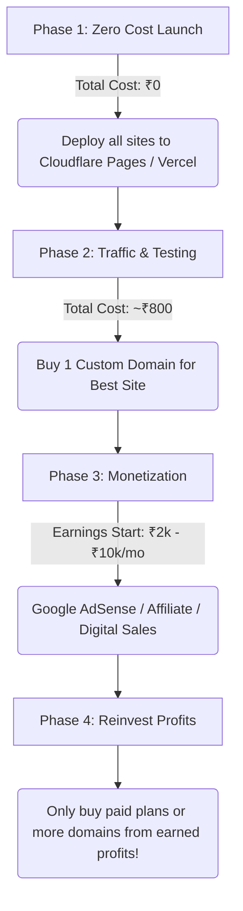
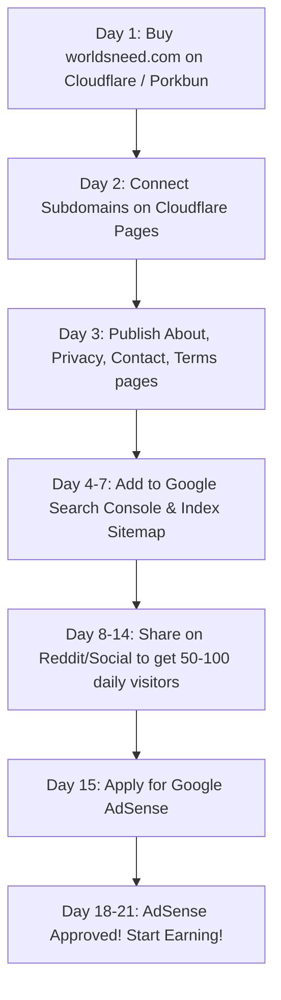

# 🚀 Hosting & Domain Strategy Guide: Complete Zero-Cost Roadmap

> **Crucial Advice**: **DO NOT spend ₹15,000 – ₹18,000 on a 4-year Hostinger plan right now.**
> If spending that money will leave you with zero savings, **it is a dangerous financial mistake**. You do **not** need paid hosting to launch, run, and scale multiple websites. You can host **all your websites for 100% FREE** with enterprise-grade speed and reliability until you are earning consistent revenue.

---

## 📑 Table of Contents
1. [The Verdict: Hostinger vs Free Cloud Hosting](#1-the-verdict-hostinger-vs-free-cloud-hosting)
2. [Is Your Website "Static" or "Dynamic"?](#2-is-your-website-static-or-dynamic)
3. [Cloudflare Pages & Vercel: The Free Powerhouses](#3-cloudflare-pages--vercel-the-free-powerhouses)
4. [How to Host Multiple Websites from Your F: Drive (Step-by-Step)](#4-how-to-host-multiple-websites-from-your-f-drive-step-by-step)
5. [The Domain Strategy: Where to Buy & The "Free Domain" Trap](#5-the-domain-strategy-where-to-buy--the-free-domain-trap)
6. [Phase-by-Phase Financial Roadmap](#6-phase-by-phase-financial-roadmap)
7. [Quick Reference Comparison Table](#7-quick-reference-comparison-table)

---

## 1. The Verdict: Hostinger vs Free Cloud Hosting

| Feature | Hostinger (4-Year Plan) | Cloudflare Pages / Vercel |
| :--- | :--- | :--- |
| **Upfront Cost** | ❌ **₹15,000 – ₹18,000** (locked for 4 years) | ✅ **₹0 (Completely Free)** |
| **Financial Risk** | ❌ **High** (all your money gone before 1st visitor) | ✅ **Zero Risk** (save your money) |
| **Number of Websites** | Limited by plan / shared resources | ✅ **Unlimited Websites** |
| **Bandwidth** | Shared limit / fair usage | ✅ **Unlimited on Cloudflare** |
| **Global Speed (CDN)** | Single server location (slower worldwide) | ✅ **300+ data centers globally** |
| **SSL (HTTPS)** | Free SSL included | ✅ **Free Auto-Renewing SSL** |
| **Modern Deployment** | Manual FTP / cPanel file manager | ✅ **Automatic git push to deploy** |
| **Scalability** | Crashes on high traffic spikes | ✅ **Handles millions of hits easily** |

### Why Hostinger's 4-Year Deal is a Trap for Beginners:
1. **Opportunity Cost**: ₹15k–₹18k is significant money. You might need it for living expenses, emergency fund, or marketing/domain registrations later.
2. **Hosting Before Revenue**: Most new websites take 3 to 12 months to start gaining traffic and generating income. Paying for 4 years upfront when you don't yet have revenue is unnecessary.
3. **Old Technology**: Hostinger shared hosting runs on traditional server stacks (Apache/PHP). Modern web platforms (Cloudflare, Vercel, Netlify) are **faster, safer, and completely free** for starter projects.

---

## 2. Is Your Website "Static" or "Dynamic"?

Many people are confused by these terms. Here is the simple distinction:

### What is a "Static" Website?
* **What it is**: Files made of HTML, CSS, client-side JavaScript, images, and JSON data.
* **How it works**: The files are sent directly to the visitor's browser. The visitor's laptop or phone does the work (e.g., formatting text, calculating numbers, searching through a loaded dictionary).
* **Does it support interactivity?** **YES!** Interactive calculators, dark/light mode toggles, offline apps (PWA), audio players, search filters, and client-side games are all "static" because they run in the browser without a backend server.
* **Are your websites static?**
  * **OmniTool Hub (`f:\Tools website`)**: **98% Static!** As stated in its documentation: *"100% client-side web utility hub... runs directly inside the user's browser, zero latency, $0 hosting cost."*
  * **WordsNeed Dictionary**: If the definitions are loaded from JSON files, a dictionary API, or client-side storage, it is **100% static**.
  * **Educational Website**: If it shows tutorials, guides, articles, embedded YouTube videos, downloadable notes, or quizzes with JavaScript, it is **100% static**.

### What is a "Dynamic" Website?
* **What it is**: A website that requires a server running continuously (like PHP, Python Django, Node.js Express) connected to a SQL database (MySQL, PostgreSQL) to render pages on the fly or authenticate users via server sessions (like WordPress, Facebook, or Amazon).

### The Cloudflare Pages Myth: "Cloudflare Pages Only Takes Static"
**This is outdated information!**
* Cloudflare Pages supports **Cloudflare Pages Functions** (Serverless backend functions written in JavaScript/TypeScript).
* You get **100,000 free serverless requests every day** at zero cost.
* Cloudflare also provides **Cloudflare D1** (Serverless SQLite database) and **KV Storage** with generous free quotas.
* **Vercel** also hosts both static frontends AND dynamic serverless APIs (like your `api/create-razorpay-order.js` file) for **100% free**.

---

## 3. Cloudflare Pages & Vercel: The Free Powerhouses

You can run your entire portfolio of websites on these two platforms without paying a single rupee:

### Option A: Cloudflare Pages (Best for Static Sites, Dictionaries, Tools)
* **Website**: [pages.cloudflare.com](https://pages.cloudflare.com/)
* **Cost**: $0 / month (Free tier has no expiry date).
* **Key Benefits**:
  * **Unlimited Bandwidth**: You will never get a surprise bill if a tool goes viral.
  * **Unlimited Websites**: Host 1, 5, or 50 websites on one account.
  * **Custom Domains**: Connect your own custom domain (e.g. `wordsneed.com`) to each project for free.
  * **Free Subdomain**: Every project gets a free `*.pages.dev` domain (e.g., `omnitool.pages.dev`, `wordsneed.pages.dev`). You don't even need to buy a domain to test live!

### Option B: Vercel (Best for Sites with Serverless APIs)
* **Website**: [vercel.com](https://vercel.com/)
* **Cost**: $0 / month (Hobby plan).
* **Key Benefits**:
  * Already configured in your `f:\Tools website` with `vercel.json` and the `/api/` folder.
  * Automatically detects and deploys Node.js serverless functions (like Razorpay payment creation, license check).
  * Free `*.vercel.app` domain for every project.

### Recommended Setup:
1. **OmniTool Hub**: Deploy to **Vercel** or **Cloudflare Pages** (takes 2 minutes).
2. **WordsNeed Dictionary**: Deploy to **Cloudflare Pages**.
3. **Educational Website**: Deploy to **Cloudflare Pages**.

---

## 4. How to Host Multiple Websites from Your F: Drive (Step-by-Step)

You do not need to upload files via FTP or file managers. Here is the modern, industry-standard workflow:

```
[ Your Laptop (F: Drive) ] 
         │  git push
         ▼
    [ GitHub ] (Free Private/Public Repositories)
         │  auto-sync webhook
         ▼
[ Cloudflare Pages / Vercel ] ──► Live on the Internet in 30 Seconds!
```

### Step 1: Create a Free GitHub Account
* Go to [github.com](https://github.com/) and register a free account.

### Step 2: Push Each Website to its Own Repository
For each project folder on your `F:` drive:
1. Open PowerShell or Terminal in that project folder.
2. Run:
   ```powershell
   git init
   git add .
   git commit -m "Initial commit: launch website"
   ```
3. Create a new repository on GitHub (e.g., `omnitool-hub`, `wordsneed-dictionary`, `edu-site`).
4. Link and push:
   ```powershell
   git remote add origin https://github.com/YOUR_USERNAME/omnitool-hub.git
   git branch -M main
   git push -u origin main
   ```

### Step 3: Connect to Cloudflare Pages
1. Sign up for a free account at [cloudflare.com](https://dash.cloudflare.com/).
2. On the left sidebar, click **Workers & Pages** ➔ **Create application** ➔ **Pages** ➔ **Connect to Git**.
3. Select your GitHub repository (e.g. `wordsneed-dictionary`).
4. Set Build Settings:
   * **Framework preset**: `None` (for plain HTML/CSS/JS) or your framework if using Vite/React.
   * **Build output directory**: `.` (or `dist` / `build` if using a bundler).
5. Click **Save and Deploy**.
6. In ~30 seconds, Cloudflare will give you a live URL like `https://wordsneed-dictionary.pages.dev`.

### Step 4: Repeat for All Your Other Websites
* There is no limit. Add your educational site, your portfolio, your tool hub—all on the same free account!

---

## 5. The Domain Strategy: Where to Buy & The "Free Domain" Trap

### The Myth: "Hostinger gives me a free domain"
* Hostinger only includes a domain free for the **first year**.
* From year 2, you pay full renewal price (~$14–$18/yr = ₹1,200–₹1,500/yr).
* **The Math**: Paying ₹15,000 for hosting just to get a ₹800 domain is losing ₹14,200 immediately!

### Where to Buy a Domain If You Need One:
When you are ready to buy a domain, buy it from a dedicated registrar that does not overcharge:

1. **Cloudflare Registrar** *(Top Recommendation)*:
   * **Price**: Wholesale cost with **0% markup**.
   * `.com` is ~$9.77/year (~₹820/year).
   * **No renewal price hikes**: What you pay in Year 1 is what you pay in Year 5.
   * Free WHOIS privacy protection forever (your phone number and address won't be leaked to spammers).
2. **Porkbun** ([porkbun.com](https://porkbun.com/)):
   * Extremely cheap (~$10/yr for `.com`).
   * Free privacy, free SSL, very clean and friendly interface.
3. **Spaceship** ([spaceship.com](https://spaceship.com/)):
   * Often has promotions for new domains ($6 to $8 for the first year).

### Do You Even Need to Buy a Domain Right Now?
**No! You can start without buying any domain:**
* Cloudflare provides: `your-project.pages.dev`
* Vercel provides: `your-project.vercel.app`
* Both are 100% free, fast, secure HTTPS URLs.
* You can share these URLs with friends, test them, and verify that everything works.
* Once you are confident and ready to brand the project, buy a single `.com` domain for **~₹800** on Cloudflare Registrar or Porkbun and link it in 1 click!

---

## 6. Phase-by-Phase Financial Roadmap

Follow this plan to ensure you never run out of money:



### Phase 1: Launch Everything for ₹0 (Today)
* Keep your ₹15,000 in your pocket.
* Upload your websites (`Tools website`, `wordsneed-dictionary`, `educational site`) to GitHub.
* Deploy each to Cloudflare Pages and Vercel.
* Test all features and ensure tools work smoothly.

### Phase 2: Pick the Champion Website
* See which website gets the most engagement, search interest, or positive feedback.
* Buy **only one** custom domain (e.g. `wordsneed.com` or `omnitoolhub.com`) for ₹800–₹900 on Cloudflare Registrar or Porkbun.
* Connect the custom domain to Cloudflare Pages with zero downtime.

### Phase 3: Monetization
* Add **Google AdSense** once you have content and traffic.
* Add **Affiliate Links** (relevant books, software, courses).
* Offer premium features or digital downloads (PDF study guides, cheat sheets, API access).

### Phase 4: Upgrade Only With Earned Profits
* When your websites make ₹5,000 to ₹20,000 per month, **use that earned money** to upgrade to paid services if needed.
* *Rule of Business*: **Never pay for enterprise infrastructure from your personal savings until the business pays for itself.**

---

---

## 8. Educational Website & Heavy Storage Strategy (How to Handle Huge Content for ₹0)

You asked: *"What about storage because content can be so much because I will add so much thing in one or single chapters or single course or single topics?"*

Here is how modern educational platforms (even Coursera, Udemy, and Khan Academy) handle large amounts of content without crashing servers or paying high hosting bills:

### Understanding What Takes Storage:

```
┌──────────────────────────────────────┬───────────────────┬────────────────────────────────────────┐
│ Content Type                         │ Size per Chapter  │ Best FREE Storage Location             │
├──────────────────────────────────────┼───────────────────┼────────────────────────────────────────┤
│ Text, Code, Quizzes, Notes, Markdown │ 5 KB – 50 KB      │ Directly inside your Website (Git)     │
│ High-Resolution Images & Diagrams    │ 200 KB – 2 MB     │ Cloudflare R2 / ImageKit (Free CDN)    │
│ Downloadable PDFs & Cheat Sheets     │ 1 MB – 10 MB      │ Cloudflare R2 / Google Drive Embed     │
│ Video Lectures (HD / 4K)             │ 200 MB – 2 GB     │ YouTube (Unlisted) / Cloudflare Stream │
└──────────────────────────────────────┴───────────────────┴────────────────────────────────────────┘
```

### 1. Pure Educational Content (Text, Markdown, Formulas, Quizzes)
* Text takes **almost zero storage**.
* A whole 500-page textbook is only **2 to 5 Megabytes**!
* You can write 1,000 chapters, hundreds of questions, notes, and exercises directly in your codebase or markdown files. GitHub gives you **up to 1 GB to 2 GB per repository completely free**. That is enough for tens of thousands of lessons!

### 2. Images, Diagrams & Infographics
* Do not bloat your Git repository with thousands of raw PNGs.
* **Solution**: **Cloudflare R2 Storage** ([cloudflare.com/developer-platform/r2](https://www.cloudflare.com/developer-platform/r2/)):
  * **10 GB of storage 100% FREE** every month.
  * **$0 Egress (Zero bandwidth fees!)**: Unlike Amazon AWS S3 which charges when users download images, Cloudflare R2 charges **₹0.00** for downloads.

### 3. Video Lectures & Course Videos (Golden Rule)
* ⚠️ **NEVER host videos directly on a shared hosting server (like Hostinger)!**
  * If you upload 10 video lectures (500 MB each = 5 GB) to Hostinger, and just 15 students start watching simultaneously, the server CPU and bandwidth will get choked, and the video will buffer endlessly or crash.
* **The Smart Professional Solution**:
  1. **YouTube (Unlisted)**: 
     * Upload course videos to YouTube and set them to **Unlisted** (only people with the link/embedded on your website can view them).
     * **Cost**: **100% FREE forever**.
     * **Benefits**: Unlimited 4K/1080p video hosting, adaptive bitrate streaming (plays smoothly on slow 3G/4G/5G mobile phones), zero buffering, zero server load.
  2. **If you want strict DRM/private video player**:
     * **Bunny.net Stream** or **Cloudflare Stream** costs pennies (less than $1/month for thousands of video views) compared to thousands on regular web hosts.

### 4. Downloadable PDFs & Notes
* Put downloadable notes, worksheets, and PDFs into **Google Drive** (share link with "Anyone with link can view") or upload them to **Cloudflare R2**.

---

## 9. WordsNeed Dictionary (Already Proven & Live!)

You shared: `https://wordsneed-dictionary.vercel.app/`

* Your WordsNeed Dictionary is a **high-tech Next.js web application** (using Turbopack, Tailwind CSS, Lucide icons, responsive layout, search, filters, audio pronunciation, and curriculum classes).
* **It is ALREADY running smoothly and for $0 on Vercel!**
* If you moved WordsNeed to a standard shared host like Hostinger, you would have to deal with Node.js version mismatches, cPanel passenger errors, and slower response times.
* Vercel is literally created by the inventors of Next.js. Keeping WordsNeed on Vercel gives you the fastest, most reliable Next.js hosting in the world for free.

---

## 10. AI Social Media Manager & Content Creation Website

You asked: *"and also I have a more website which is ai social media manager and content creation?"*

An AI Social Media Manager is a modern web application that involves:
1. **Interactive Frontend**: Dashboard to write prompts, select tone/platform, preview tweets, LinkedIn posts, Instagram captions.
2. **AI API Calling**: Calling models like Google Gemini API, OpenAI GPT, or Anthropic Claude.
3. **Database**: Saving user accounts, past generated drafts, scheduled posts, and user templates.

### Why Hostinger CANNOT run this properly:
* Hostinger shared hosting runs Apache and PHP. It struggles with:
  * Server-Sent Events (SSE) streaming (where the AI types words one by one).
  * Long-running AI background tasks.
  * Node.js modern frameworks.

### The 100% FREE Modern Stack for your AI Social Media Manager:
1. **Frontend + AI Streaming API**: **Vercel**
   * Vercel has the **Vercel AI SDK** built specifically for streaming AI responses.
   * Host the frontend and backend serverless endpoints on Vercel for **$0**.
2. **Database (User Accounts, Saved Posts, Templates)**: **Supabase** ([supabase.com](https://supabase.com/))
   * Enterprise-grade PostgreSQL database with **500 MB free database storage** and **1 GB file storage**.
   * Built-in User Authentication (Email/Password, Google login) completely free for up to 50,000 monthly active users!
3. **AI Model Engine**: **Google Gemini API** ([aistudio.google.com](https://aistudio.google.com/))
   * Google AI Studio gives developers **free tier quotas** to generate text with Gemini 1.5 Flash / Gemini 2.0 Flash at no cost!
   * **Groq** ([groq.com](https://groq.com/)) also offers blazing fast free-tier access to Llama 3 models.

---

## 11. Final Summary: Your 4-Website Free Ecosystem

| Website | Best Platform | Database / Storage Solution | Cost |
| :--- | :--- | :--- | :--- |
| **OmniTool Hub** (`f:\Tools website`) | **Vercel / Cloudflare Pages** | Client-side Browser Storage | **₹0.00** |
| **WordsNeed Dictionary** | **Vercel** *(Already live!)* | Next.js API / Static Data | **₹0.00** |
| **Educational Website** | **Cloudflare Pages / Vercel** | **YouTube** (Videos) + **R2** (PDFs/Images) | **₹0.00** |
| **AI Social Media Manager** | **Vercel** | **Supabase** (Auth & DB) + **Gemini API** | **₹0.00** |

**Total Cost for All 4 Projects**: **₹0.00 / month** (Save your ₹15,000–₹18,000 in your bank account!)

---

## 12. Monetization Rules: Vercel vs Cloudflare Pages vs Google AdSense & Rewarded Video Ads

### A. Vercel Hobby Plan vs Cloudflare Pages Free: Commercial Use Rules
* **Vercel Hobby Plan**:
  * You are **100% correct!** Vercel's Terms of Service state that the Hobby plan is for *personal, non-commercial use*. If your website makes money (via Google Ads, subscriptions, or paid licenses), Vercel's terms state you should upgrade to **Vercel Pro ($20/month per user)**.
* **Cloudflare Pages Free**:
  * **Zero Commercial Restrictions!** Cloudflare explicitly allows commercial websites, advertising, paid subscriptions, and business platforms on its **100% Free Tier**. Cloudflare makes its billions from enterprise clients, so they do not restrict developers from monetizing on their free plan.

### B. Google AdSense & Free Subdomains: The Truth
* You are **100% correct!** Google AdSense will **reject** free subdomains like `omnitool.vercel.app` or `wordsneed.pages.dev`. Google AdSense requires an official top-level domain (e.g. `wordsneed.com`, `omnitool.in`).
* **The Crucial Realization**:
  * To get approved by Google AdSense, you **ONLY need a Domain Name** (e.g., `omnitool.com` for ~₹820/year or `.in` for ~₹500/year).
  * You **DO NOT need Hostinger paid hosting**!
  * You connect your custom domain to **Cloudflare Pages (100% Free)**.
  * Google AdSense reviews `https://www.yourdomain.com`. It sees a fast, secure, custom-domain website and approves it. Google does not care whether your hosting is free or paid—only that you own the domain!

### C. "Unlock Pro by Watching Video Ads" (Rewarded Web Ads)
For your proposed `AD-LOCK` tier (unlocking a tool for 24 hours by watching an ad):
1. **Google Rewarded Video (H5 Games & Web)**:
   * Requires an active Google AdSense account linked to your verified custom domain.
2. **Alternative Fast-Approval Ad Networks for Web Rewarded Video**:
   * **Monetag** ([monetag.com](https://monetag.com/)): Specialized in web rewarded video ads, interstitial ads, and push notifications with fast approval.
   * **Adsterra** ([adsterra.com](https://adsterra.com/)): Easy approval for utility tool websites, high CPMs.
   * **AdinPlay** ([adinplay.com](https://adinplay.com/)): Leading web video monetization for interactive web apps.
3. **Best Practice**:
   * Buy **1 custom domain** for your main project (~₹500 to ₹820).
   * Host on **Cloudflare Pages** (₹0 hosting cost, 100% legal for commercial ad earning).
   * Integrate rewarded video script into your frontend unlock logic.

---

## 13. Summary Checklist: The Smartest Path Forward

1. **Host on Cloudflare Pages**: Unlimited bandwidth, free forever, 100% legal for commercial earnings and ads.
2. **Buy ONLY a Custom Domain**:
   * Cost: ₹500/year for `.in` or ₹820/year for `.com`.
   * **Never spend ₹15,000–₹18,000 on Hostinger.**
3. **Attach Domain to Cloudflare Pages**: Takes 2 minutes in Cloudflare DNS.
4. **Apply for Google AdSense & Web Rewarded Ads**: Get approved with your custom domain.
5. **Keep 100% of your earnings**: Zero hosting deductions!

---

---

## 14. The 1-Domain + Subdomains Strategy: Is It Good? (Verdict: EXCELLENT!)

Using **worldsneed.com** as your master root domain and putting each project on a **subdomain** is the smartest, most profitable architecture.

```
                          ┌──────────────────────────┐
                          │     worldsneed.com       │ (Root Brand Portal)
                          └─────────────┬────────────┘
         ┌──────────────────────────────┼──────────────────────────────┐
         ▼                              ▼                              ▼
┌────────────────────────┐     ┌──────────────────────┐       ┌──────────────────────┐
│ omnitool.worldsneed.com│     │ learn.worldsneed.com │       │  ai.worldsneed.com   │
│ (OmniTool Hub)         │     │ (Educational Hub)    │       │ (AI Studio App)      │
└────────────────────────┘     └──────────────────────┘       └──────────────────────┘
                                        │
                                        ▼
                               ┌──────────────────────────┐
                               │   words.worldsneed.com   │
                               │ (WordsNeed Vocabulary)   │
                               └──────────────────────────┘
```

#### 1. Massive Money Savings
* Cost of 4 separate domains: ₹820 × 4 = **₹3,280 / year**.
* Cost of 1 domain (`worldsneed.com`) with subdomains: **~₹820 / year total**.
* **Subdomains are 100% FREE and UNLIMITED on Cloudflare**. You can create 50 subdomains at zero extra charge.

#### 2. Huge Google AdSense Advantage
* When you get Google AdSense approved for your root domain (`worldsneed.com`), **all your subdomains inherit approval under the same account**.
* You don't have to wait 2 to 4 weeks getting separate approvals for every single site!

#### 3. Cross-Promotion & Traffic Synergy
* A visitor using your vocabulary & multilingual explorer at `words.worldsneed.com` sees your navigation bar pointing to `omnitool.worldsneed.com` and `learn.worldsneed.com`.
* All your projects help each other grow without paying for advertising.

#### 4. Clean Cloudflare Pages Setup
* In Cloudflare Pages / DNS, each project connects to its own subdomain:
  * Root Portal (`worldsneed-landing-page`) ➔ `worldsneed.com`
  * Words & Language (`wordsneed` repo) ➔ `words.worldsneed.com`
  * Developer Tools (`Tools website` repo) ➔ `omnitool.worldsneed.com`
  * Educational Platform ➔ `learn.worldsneed.com`
  * AI Studio App ➔ `ai.worldsneed.com`
* Each gets its own independent automatic deployment and free SSL certificate!

---

## 15. The "WorldsNeed" Umbrella Brand Architecture: Full Analysis

You decided: **Buy `worldsneed.com` as the parent master brand, and host all projects under it as subdomains.**

### 1. Is this vision good?
**YES, IT IS OUTSTANDING!**
"WorldsNeed" (meaning *"Solutions that the World Needs"*) is a fantastic master umbrella brand. It works just like:
* **Zoho**: `mail.zoho.com`, `crm.zoho.com`, `books.zoho.com`
* **Google**: `docs.google.com`, `drive.google.com`, `meet.google.com`
* **Microsoft**: `teams.microsoft.com`, `onedrive.microsoft.com`

Having a parent company/brand gives your projects legitimacy and authority.

---

### 2. ⚠️ Spelling Verification: `worldsneed.com`
* **CORRECT**: **`w - o - r - l - d - s - n - e - e - d . c o m`** (with an **'r'** for World, and an **'l'**).
* **CHECK BEFORE PAYING**: Double-check every single letter: `w-o-r-l-d-s-n-e-e-d`.

---

### 3. Subdomain Naming: Short vs Long (Which is Better?)

| Project | Longer Subdomain | Cleaner Recommended Subdomain | Why Shorter is Better |
| :--- | :--- | :--- | :--- |
| **WordsNeed** | `wordsneed.worldsneed.com` | **`words.worldsneed.com`** | `words.worldsneed.com` is short, punchy, and broad. It encompasses dictionaries, vocabulary, idioms, word games, and languages without being limited. |
| **OmniTool Hub** | `omnitool-hub.worldsneed.com` | **`omnitool.worldsneed.com`** | Clean, branded, memorable. |
| **Education Hub** | `educational-website.worldsneed.com` | **`learn.worldsneed.com`** or **`edu.worldsneed.com`** | Short, punchy, looks like Khan Academy or Coursera. |
| **AI Content Studio** | `ai-social-media.worldsneed.com` | **`ai.worldsneed.com`** | Modern, premium, ultra-fast to remember. |

---

## 16. Google AdSense Approval Secrets: Do You Need Visitors First?

You asked: *"Will AdSense approve new websites without visitors or first I need to get visitors?"*

Here is the exact truth directly from Google AdSense policies and experience:

### 1. Does Google officially require a minimum traffic count?
* **Officially**: **NO**. Google does not state a minimum traffic requirement like 1,000 visitors/day.
* **In Practice (The Reality)**: If you register a domain today, put up a blank template with 0 visitors, and immediately apply to AdSense, **Google will REJECT it within 48 hours** with the error: **"Low Value Content"** or **"Site Under Construction"**.

### 2. Why does Google reject brand-new 0-traffic sites?
Google uses automated AI reviewer bots. If the bot crawls your website and sees:
1. Very few pages or thin content.
2. No user activity or engagement signals.
3. Missing mandatory legal pages.
It assumes the site is a low-quality "made for ads" site and rejects it.

---

### 3. The 5-Step Checklist to Get Guaranteed AdSense Approval

Follow these 5 steps before clicking "Submit" on Google AdSense:

#### Step 1: Add the 4 Mandatory Legal Pages (100% Required)
Google will **instantly reject** your site if you don't have these in your header or footer:
1. **About Us**: Explain what WorldsNeed is, your mission, and who created it.
2. **Contact Us**: Provide a working email address (e.g. `support@worldsneed.com` or a contact form).
3. **Privacy Policy**: **CRITICAL** — Must explicitly state: *"We use cookies and third-party advertising partners like Google AdSense to serve ads."* (You can use a free Privacy Policy generator online).
4. **Terms of Service**: Standard rules for using your tools.

#### Step 2: Content Volume (Substantial Original Content)
* **For WordsNeed (`words.worldsneed.com`)**: Ensure words with full definitions, examples, and pronunciation cards are live.
* **For OmniTool Hub (`omnitool.worldsneed.com`)**: Ensure all 50+ tools are functional with clear descriptions and guides.
* **On the root `worldsneed.com`**: Have a professional intro portal explaining all available tools and platforms.

#### Step 3: Index Your Pages on Google Search Console
1. Create a free account on [Google Search Console](https://search.google.com/search-console).
2. Add your domain `worldsneed.com` (Cloudflare DNS verifies it automatically in 1 click).
3. Submit your `sitemap.xml`.
4. Wait 3 to 7 days until Google says *"Pages Indexed"*.

#### Step 4: Get a Small Stream of Initial Visitors (50–100 Visitors/Day)
You do **not** need thousands of visitors, but you should have **50 to 100 visitors per day** for 1 to 2 weeks before applying:
* Share your tools in developer Discord servers, Telegram student groups, Reddit (`r/webdev`, `r/tools`, `r/learnenglish`), Twitter/X, and LinkedIn.
* Have friends, students, and classmates use the dictionary and tools.
* When Google reviews your site, their analytics will see real human users browsing pages and clicking tools. This gives your application a **99% approval rating**!

#### Step 5: Clean, Fast UI & Zero Broken Links
* Ensure your site has **SSL (HTTPS)** enabled (Cloudflare does this automatically).
* No broken 404 links or "Under Construction" placeholder banners.

---

## 17. Complete Launch Timeline (Step-by-Step)



---

*File updated locally in your project root: `f:\Tools website\HOSTING_AND_DOMAINS_DECISION_GUIDE.md`*


