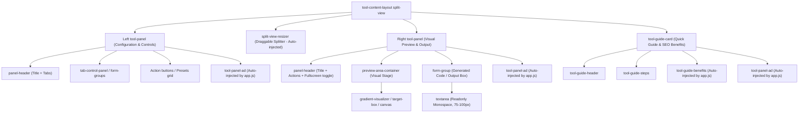
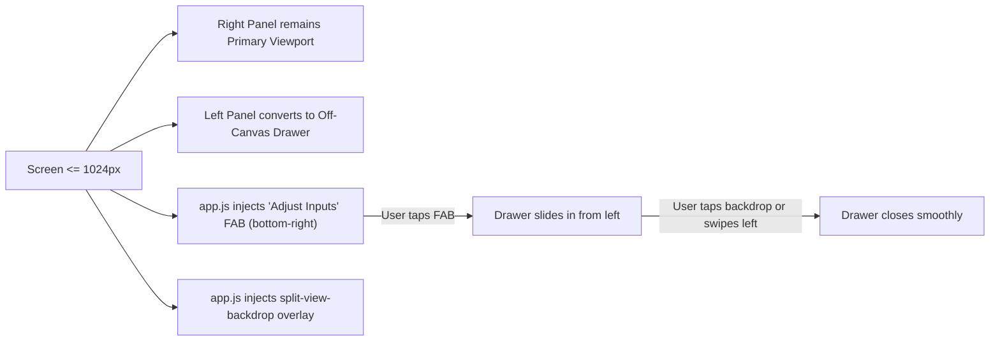

# OmniTool Hub - Standard Tool Layout & Architecture Specification

> **Canonical Reference Standard**: `CSS Studio Suite` ([`tools/css-studio.js`](file:///f:/Tools%20website/tools/css-studio.js))  
> **Status**: Official UI/UX & Layout Baseline for OmniTool Hub v2  
> **Target Audience**: Human Developers, Antigravity, and all Autonomous AI Agents

---

## 📌 1. Executive Summary

Every tool in OmniTool Hub must adhere to a unified, human-grade, client-side architectural blueprint modeled directly after the **CSS Studio Suite** (`tools/css-studio.js`).

This specification defines:
1. **The 2-Panel Split-View Layout** (Left Configuration Panel + Right Visual Preview & Code Output Panel).
2. **Standard Module Lifecycle Interface** (`renderUI`, `init`, `cleanup`).
3. **Rigid Box Sizing Rules** (Preventing collapsed previews and runaway heights).
4. **Scrolling Architecture** (Independent panel scrolling, elimination of double scrollbars).
5. **Responsive Mobile Drawer System** (Seamless adaptation with the "Adjust Inputs" FAB and slide-out dock).
6. **Fullscreen Visualizer Expansion** (`preview-fullscreen` standard).
7. **Ecosystem Integrations** (Automatic ad distribution, dynamic guide card benefits, and floating scroll-down arrows).

---

## 🏛️ 2. The Canonical DOM Hierarchy

Every tool interface returned by `renderUI()` must follow this exact DOM structure:



### Complete HTML Blueprint
```html
<div class="tool-content-layout split-view">
  <!-- 1. LEFT PANEL: Configuration & Controls -->
  <div class="tool-panel">
    <div class="panel-header">
      <h3>Configuration</h3>
      <!-- Optional: Multi-mode subtabs -->
      <div style="display: flex; gap: 8px; width: 100%; max-width: 100%; flex-wrap: wrap;" id="my-tool-tabs">
        <button class="keyboard-tab active" data-tab="tab1">Mode 1</button>
        <button class="keyboard-tab" data-tab="tab2">Mode 2</button>
      </div>
    </div>

    <!-- Active Tab / Form Controls -->
    <div id="panel-tab1-controls" class="tab-control-panel">
      <div class="form-row">
        <div class="form-group">
          <label for="input-option">Option</label>
          <select class="form-select" id="input-option">
            <option value="opt1">Option 1</option>
          </select>
        </div>
      </div>
      <!-- Presets / Quick Actions -->
      <div class="form-group" style="margin-top: 12px;">
        <label>Presets</label>
        <div style="display: flex; gap: 6px; flex-wrap: wrap; margin-top: 4px;">
          <button class="tool-btn secondary" id="preset-1">Preset 1</button>
        </div>
      </div>
    </div>
  </div>

  <!-- Note: app.js automatically injects .split-view-resizer between Panel 1 and Panel 2 on desktop -->

  <!-- 2. RIGHT PANEL: Visual Preview & Output -->
  <div class="tool-panel">
    <div class="panel-header">
      <h3>Visual Preview</h3>
      <div class="panel-actions" style="display: flex; gap: 6px; align-items: center;">
        <!-- Fullscreen / Mode triggers -->
        <button class="tool-btn secondary" id="preview-fullscreen-btn" title="Toggle Fullscreen Preview">
          <svg viewBox="0 0 24 24" width="13" height="13" fill="none" stroke="currentColor" stroke-width="2"><path d="M8 3H5a2 2 0 0 0-2 2v3m18 0V5a2 2 0 0 0-2-2h-3m0 18h3a2 2 0 0 0 2-2v-3M3 16v3a2 2 0 0 0 2 2h3"/></svg>
        </button>
      </div>
    </div>

    <!-- 2A. Dedicated Visual Preview Stage -->
    <div class="preview-area-container" style="flex: 1; min-height: 280px; display: flex; flex-direction: column; justify-content: center; position: relative;">
      <div id="visual-preview-stage" style="flex: 1; border-radius: 8px; display: flex; align-items: center; justify-content: center; min-height: 250px;">
        <!-- Visual Target Element / Canvas / Interactive Node -->
      </div>
    </div>

    <!-- 2B. Compact Output / Code Box -->
    <div class="form-group" style="margin-top: 12px;">
      <div class="panel-header" style="border: none; padding: 0; margin-bottom: 6px;">
        <label style="margin: 0;">Generated Output</label>
        <button class="tool-btn accent-emerald" id="my-tool-copy-btn">
          <svg viewBox="0 0 24 24"><rect x="9" y="9" width="13" height="13" rx="2" ry="2"></rect><path d="M5 15H4a2 2 0 0 1-2-2V4a2 2 0 0 1 2-2h9a2 2 0 0 1 2 2v1"></path></svg> Copy Output
        </button>
      </div>
      <textarea class="form-input" id="my-tool-code-output" readonly style="font-family: var(--font-mono); font-size: 12px; height: 75px; resize: none; width: 100%; box-sizing: border-box;" aria-label="Generated Output"></textarea>
    </div>
  </div>

  <!-- 3. BOTTOM: Full-Width Quick Guide Card -->
  <div class="tool-guide-card" style="flex-basis: 100%;">
    <div class="tool-guide-header">
      <div class="tool-guide-title">
        <svg viewBox="0 0 24 24"><circle cx="12" cy="12" r="10"></circle><line x1="12" y1="16" x2="12" y2="12"></line><line x1="12" y1="8" x2="12.01" y2="8"></line></svg>
        <span id="my-tool-guide-title">Quick Guide: How to Use This Tool</span>
      </div>
    </div>
    <div class="tool-guide-steps" id="my-tool-guide-steps">
      <!-- Steps rendered here -->
    </div>
  </div>
</div>
```

---

## ⚙️ 3. Standard Module Lifecycle Interface

Every tool module in `tools/*.js` must export an ES Module object:

```javascript
export default {
  id: "my-tool-id",
  name: "My Tool Display Name",

  // 1. Synchronous HTML template string returning the dual-panel layout
  renderUI() {
    return `...`;
  },

  // 2. Lifecycle mount: binds event listeners, initializes UI state, updates preview
  async init(container, appInstance) {
    // Always scope queries to container
    const root = container || document;
    
    // Bind buttons, sliders, copy actions
    // Trigger initial preview computation
  },

  // 3. Lifecycle unmount (Critical for memory cleanup)
  cleanup() {
    // Clear active intervals, cancel animation frames, release WebCam/Media streams, terminate workers
  }
};
```

---

## 📐 4. Box Sizing & Dimension Standards

To preserve visual symmetry, zero layout shift, and prevent double scrollbars, adhere strictly to these sizing rules:

| Element | Sizing Rule | Rationale |
| :--- | :--- | :--- |
| **Desktop `.tool-panel`** | `height: calc(100vh - 240px); min-height: 480px; overflow-y: auto;` (Governed by `style.css`) | Locks panels to viewport height; enables independent vertical scrolling without scrolling the main document window. |
| **Panel Direct Children** | `flex-shrink: 0;` (Governed by `style.css`) | Prevents inputs, buttons, or labels from squishing when content exceeds panel height. |
| **`.preview-area-container`** | `flex: 1; min-height: 280px; display: flex; flex-direction: column; justify-content: center; position: relative;` | Fluidly absorbs all available vertical space in the preview panel. |
| **Inner Preview Element** | `min-height: 250px; border-radius: 8px;` | Guarantees adequate breathing room for visual canvas, shapes, or mockups. |
| **Code / Text Output Box** | `height: 75px; resize: none; width: 100%; box-sizing: border-box;` (or `height: 90px;`) | Compact, non-resizable code box leaves the majority of space for visual inspection. |
| **Quick Guide Card** | `flex-basis: 100%; margin-top: 0;` | Spans the full width beneath the two panels. |

> [!CAUTION]
> **Anti-Pattern to Avoid**: Never write hardcoded inline heights like `height: 480px;` or `height: 600px;` on inner textareas, canvases, or sub-divs. Hardcoding large heights causes nested double scrollbars (inner element scrolls AND outer `.tool-panel` scrolls), breaking user wheel navigation.

---

## 📜 5. Scrolling Architecture & Scrollbar Standards

1. **Independent Dual-Panel Scrolling**:
   - The left panel and right panel scroll completely independently.
   - When a user adjusts numerous form controls on the left, the visual preview on the right remains locked in view.
2. **Main Page Scroll Lock**:
   - The primary browser viewport does not scroll while interacting with the tool panels.
   - The only reason to scroll the page is down to the bottom `.tool-guide-card`.
3. **Slim Modern Scrollbar Tokens**:
   - All `.tool-panel`s use custom slim webkit scrollbars:
     ```css
     .tool-content-layout.split-view > .tool-panel:not(.tool-guide-card)::-webkit-scrollbar {
       width: 6px;
       height: 6px;
     }
     .tool-content-layout.split-view > .tool-panel:not(.tool-guide-card)::-webkit-scrollbar-thumb {
       background: rgba(255, 255, 255, 0.1);
       border-radius: 3px;
     }
     ```

---

## 📱 6. Mobile Adaptability & Responsive Drawer System

When screen width is `<= 1024px`, OmniTool Hub automatically converts the split layout into a mobile-first live preview interface:



1. **Right Panel (Preview) Priority**: On mobile, users see the live visual output first.
2. **Floating Action Button (`.adjust-settings-fab`)**: Injected into the split view, allowing the user to toggle the control settings drawer at any time.
3. **Floating Dock Header (`.floating-dock-header`)**: Injected at the top of the left drawer with "Live Editor & Controls", width toggle, and minimize buttons.
4. **Touch Gestures**: The left panel listens for left-swipe touch gestures (`deltaX > 60px`) to automatically dismiss the drawer.

---

## 🔍 7. Desktop Draggable Split-View Resizer

On screens `>= 1025px`, `app.js` (`initLayoutSizer`) dynamically injects an interactive vertical divider:
- **Class**: `.split-view-resizer`
- **Features**:
  - Live drag-to-resize ratio (updating `--split-ratio` from 20% to 80%).
  - Real-time percentage tooltip (`50% | 50%`).
  - Centered grab pill handle with 3 status dots.
  - Hover reset button (`.resizer-reset-btn`) and double-click to snap back to 50/50.
  - State persistence: User's chosen split ratio is saved in `localStorage["omnitool_split_<toolId>"]`.

---

## 🖥️ 8. Fullscreen Preview Expansion Standard (`preview-fullscreen`)

To allow users to inspect visual outputs or work in distraction-free mode:
1. Toggling `.preview-fullscreen` on the right `.tool-panel` fixes it to `position: fixed; inset: 0; z-index: 1000;`.
2. The inner `.preview-area-container` automatically expands to `height: auto !important; min-height: 70vh !important;`.
3. The `.panel-header` turns sticky with glassmorphism backdrop blur.
4. The desktop split-resizer is automatically hidden via `:has(.preview-fullscreen)` CSS rules.

---

## 🎯 9. Monetization & Guide Card Ecosystem Integrations

When a tool conforms to the canonical split-view structure:
1. **Ad Placement Symmetry**:
   - `app.js` distributes 3 ad units cleanly without shifting layout:
     - 1 ad at the bottom of the Left Panel (`.tool-panel-ad`).
     - 1 ad at the bottom of the Right Panel (`.tool-panel-ad`).
     - 1 ad at the bottom of the `.tool-guide-card`.
2. **SEO Benefits Auto-Injection**:
   - `app.js` finds `.tool-guide-card` and injects:
     - "💡 How it Benefits You" bullet list from `this.toolBenefits[toolId]`.
     - Direct link to the SEO Guide Post (`guides/<tool-id>.html`).
3. **Floating Bouncing Guide Arrow (`.guide-scroll-arrow`)**:
   - Automatically injected in the bottom-right of the viewport.
   - Clicking it smoothly scrolls the user directly to `.tool-guide-card`.
   - Automatically fades out when the user scrolls past 80px.

---

## 📊 10. Audit & Compliance Analysis of Codebase Tools

An automated architectural audit of all 86 tool files in `tools/*.js` against this standard revealed:

### Category A: Gold Reference Implementations (Fully Compliant)
- [`tools/css-studio.js`](file:///f:/Tools%20website/tools/css-studio.js)
- [`tools/color-lab.js`](file:///f:/Tools%20website/tools/color-lab.js)

### Category B: Active Tools with Layout / Sizing Deviations

#### B1. Missing Quick Guide Card (`.tool-guide-card`) (18 tools)
*Consequence: Missing "How it Benefits You" section, missing guide post link, broken 3rd ad placement, and missing `.guide-scroll-arrow`.*
- `color-extractor.js`
- `crop-pdf.js`
- `favicon-generator.js`
- `images-to-pdf.js`
- `lorem-generator.js`
- `mp4-to-mp3.js`
- `pdf-forms.js`
- `pdf-security.js`
- `pdf-watermark.js`
- `qr-scanner.js`
- `redact-pdf.js`
- `robots-generator.js`
- `screen-recorder.js`
- `sign-pdf.js`
- `temp-mail.js`
- `video-speed.js`
- `video-to-gif.js`
- `voice-recorder.js`

#### B2. Hardcoded Large Fixed Heights (>= 350px) Causing Double Scrollbars (35 tools)
*Consequence: Creates nested scroll traps, awkward wheel behavior, and misaligned panels.*
- `markdown-preview.js` (Has `overflow: hidden; min-height: 480px;` on panel and `min-height: 440px;` on textarea)
- `text-diff.js` (`380px` fixed heights)
- `pdf-utilities.js` (`480px`, `640px` fixed heights)
- `screenshot-capture.js` (`520px` fixed height)
- `code-playground.js` (`480px` fixed height)
- `curl-converter.js` (`420px`)
- `json-to-types.js` (`460px`)
- `robots-generator.js` (`380px`)
- `lorem-generator.js` (`380px`)
- `screen-recorder.js` (`440px`)
- `video-speed.js` (`420px`)
- `video-to-gif.js` (`380px`)
- `temp-mail.js` (`380px`, `360px`)
- `pdf-organizer.js`, `pdf-annotate.js`, `pdf-ai.js`, `compare-pdf.js`, `crop-pdf.js`, `redact-pdf.js`, `sign-pdf.js`, `pdf-watermark.js`, `pdf-forms.js`, `scan-to-pdf.js`, `word-pdf.js`, `excel-pdf.js`, `pptx-pdf.js`, `html-to-pdf.js`, `images-to-pdf.js`, `pdf-to-markdown.js`

#### B3. Missing Dedicated Preview Container (`.preview-area-container`) (62 tools)
*Consequence: Text-based tools and utility converters drop raw textareas directly into the right panel instead of using a structured stage wrapper and compact output box.*

### Category C: Suite Hosts (Dynamic Subtool Mounts) (5 suites)
- `qr-studio.js`
- `audio-suite.js`
- `pdf-converter-hub.js`
- `pdf-editor-suite.js`
- `pdf-security-suite.js`
*Architecture*: These do not output the split view directly in `renderUI()`; they render `.suite-wrapper` with a tab navigator and mount the active subtool into a host container (`#subtool-host`). `app.js` runs a secondary `initLayoutSizer(viewport)` once the subtool mounts.

### Category D: Legacy Consolidation Stubs (18 files)
- `box-shadow.js`, `gradient-generator.js`, `glassmorphism-generator.js` (Consolidated into `css-studio`)
- `json-formatter.js`, `json-yaml-csv.js`, `sql-beautifier.js` (Consolidated into `formatter-suite`)
- `text-converter.js`, `url-encoder.js`, `base64.js` (Consolidated into `text-encoder-suite`)
- `hash-generator.js`, `aes-crypto.js`, `rsa-generator.js` (Consolidated into `crypto-suite`)
- `password-generator.js`, `uuid-generator.js` (Consolidated into `security-suite`)
- `color-palette.js`, `color-shades.js` (Consolidated into `color-lab`)
- `date-calculator.js`, `epoch-converter.js` (Consolidated into `datetime-suite`)
*Architecture*: Redirect stubs with warning messages directing users to parent suites.

---

## 📋 11. Tool Layout Verification Checklist

Before publishing, refactoring, or adding any tool to OmniTool Hub, verify:

- [ ] **Outer Container**: Has `class="tool-content-layout split-view"`.
- [ ] **Dual Panels**: Contains exactly two `.tool-panel` elements (Left: Config/Inputs, Right: Preview/Output).
- [ ] **Quick Guide**: Contains `.tool-guide-card` with `flex-basis: 100%;` at the bottom.
- [ ] **No Hardcoded Large Heights**: No inner elements have `height: >= 350px` inline styles.
- [ ] **Visualizer Stage**: Visual tools wrap preview elements inside `.preview-area-container`.
- [ ] **Code Box**: Output code textareas have `height: 75px; resize: none;` with an emerald copy button.
- [ ] **Mobile Drawer Test**: Shrinking viewport below `1024px` displays the "Adjust Inputs" FAB and opens the control panel as a slide-out drawer.
- [ ] **Desktop Resizer Test**: Expanding viewport above `1024px` displays `.split-view-resizer` between panels, and dragging smoothly resizes panels.
- [ ] **Guide Arrow Test**: On page load, the bouncing down arrow appears in the lower-right corner and smoothly scrolls to `.tool-guide-card` when clicked.

