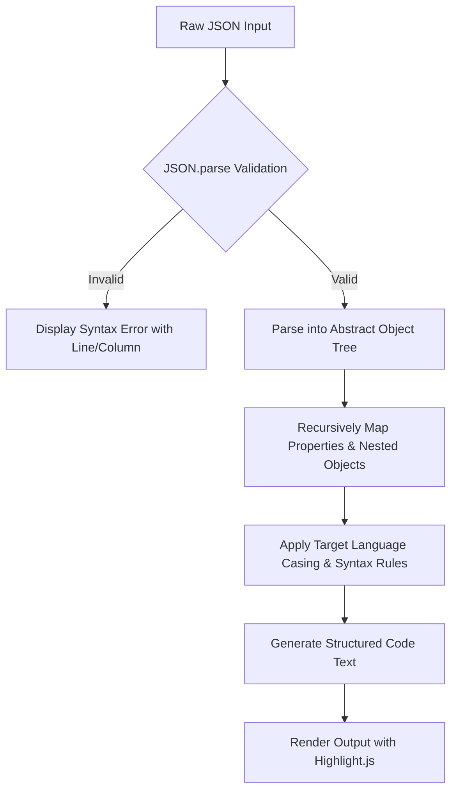
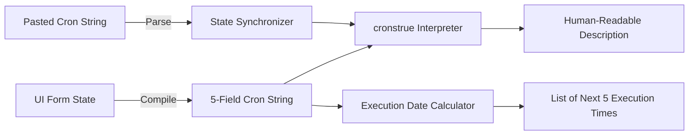
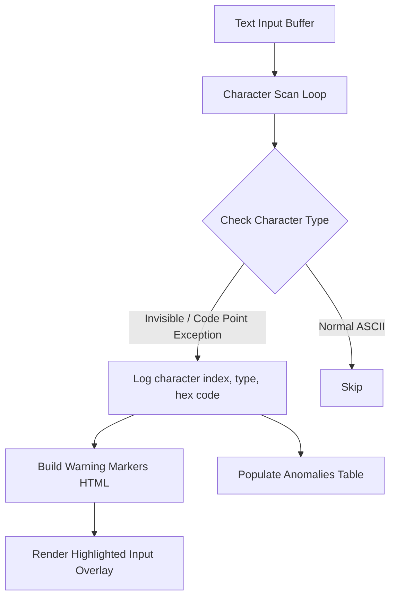

# OmniTool Hub - Developer Tools Expansion Specification

This document details the architectural, user interface (UI), and functional specifications for six (6) advanced client-side developer tools proposed for the **OmniTool Hub** expansion. Each tool is designed to run 100% in-browser, maintaining our core promise of absolute privacy, zero server latency, and offline support.

---

## 1. JSON-to-Code Interface Converter

Converts a raw JSON payload into strongly-typed interfaces, classes, or struct models for major programming languages.

### A. User Interface Layout
*   **Split-Screen Workspace**: 
    *   **Left Input Panel**: A text editor area with automatic bracket-matching, line numbers, and live syntax validation.
    *   **Right Output Panel**: A read-only code display area featuring code syntax highlighting, custom theme colors, and a dominant "Copy Code" action button.
*   **Language Selection Tabs**: A sleek, high-fidelity tab bar above the output panel: `TypeScript`, `Go (Structs)`, `Rust (Structs)`, `Java (POJO)`, `Python (Pydantic)`.
*   **Controls Header**: A toolbar containing a root-level structure name text field (defaulting to `RootObject`) and an layout/spacing configurations dropdown.

### B. User Controls & Parameters
*   **Root Class Name (`string`)**: Defines the name of the top-level interface/struct.
*   **Export Style (`select`)**:
    *   *TypeScript*: Choose between `interface` or `type`.
    *   *Python*: Choose between `TypedDict`, `dataclass`, or `Pydantic Model`.
    *   *Java*: Choose between standard `class` or `record`.
*   **Casing Normalization (`checkbox`)**: Force property names to standard casing styles (`camelCase`, `snake_case`, `PascalCase`).
*   **Annotation Wrappers (`checkbox`)**:
    *   *Go*: Add structural tags like ``json:"key_name"``.
    *   *Rust*: Add Serde attributes like `#[derive(Serialize, Deserialize)]`.
    *   *Java*: Add Jackson or Gson annotations.

### C. Data Processing Flow

### D. Client-Side Libraries & Dependencies
*   **Custom AST Walker**: Native recursive JavaScript functions to traverse properties and generate the matching syntax.
*   **Highlight.js**: For syntax highlighting the generated code dynamically.

---

## 2. cURL to Fetch / Axios Converter

Converts command-line `cURL` requests into modern browser Fetch API calls or Axios promises.

### A. User Interface Layout
*   **Left Input Panel**: Large text area with placeholder: `Paste curl -X POST "https://api.example.com/data" -H "Content-Type: application/json" ...`
*   **Right Code Panel**: Clean tabbed output pane displaying formatted, ready-to-paste code: `Fetch (ES6)`, `Axios (JS)`, `Python Requests`, `Go HTTP`.
*   **Copy Code Float**: A quick-action hovering clipboard button in the upper right of the output box.

### B. User Controls & Parameters
*   **Syntax Preference (`select`)**:
    *   *JS*: Choose between `async/await` syntax or standard `.then()` Promise chaining.
    *   *TypeScript*: Toggle typing parameters for response data.
*   **Credentials Option (`checkbox`)**: Toggle inclusion of `credentials: 'include'` (for passing cookies).
*   **Node.js Polyfill (`checkbox`)**: Format the JS output for Node (`node-fetch` / `axios` imports).

### C. Data Processing Flow
1.  **Tokenization**: Split the cURL command string by whitespaces while respecting double and single quotes.
2.  **Argument Parsing**: Iterates through arguments looking for flags:
    *   `-X`, `--request` ➔ Defines the HTTP Method (GET, POST, etc.).
    *   `-H`, `--header` ➔ Extracts headers into a key-value object.
    *   `-d`, `--data`, `--data-raw` ➔ Extracts payloads.
    *   URL token detection (first token not matching flag arguments).
3.  **Code Compilation**: Maps HTTP attributes to standard Fetch/Axios templates.

### D. Client-Side Libraries & Dependencies
*   **Custom cURL Tokenizer**: Pure JavaScript utility to split command lines securely (handles backslashes, escape quotes, and line continuations).

---

## 3. Visual Cron Expression Builder & Descriptor

Provides a graphical dashboard to build cron expressions and parses cron strings into natural English.

### A. User Interface Layout
*   **Workspace Tabs**: Divided into segment controls: `Minutes`, `Hours`, `Day of Month`, `Month`, `Day of Week`.
*   **Visual Selectors**:
    *   *Checkbox Grids*: Pick specific hours/days.
    *   *Sliders*: Pick step values (e.g., "Every 5 minutes").
    *   *Radio Buttons*: Toggle between "Every hour", "Specific hours", or "Range of hours".
*   **Bottom Preview Card**:
    *   A massive, styled badge displaying the compiled cron string: `15 14 * * 1-5`.
    *   A human-readable label: *"At 14:15, Monday through Friday"*.
    *   **Future Dates Panel**: Displays the next five execution times calculated client-side.

### B. User Controls & Parameters
*   **Cron Format Selector (`select`)**: Choose between **Standard Cron (5-fields)** and **Quartz Cron (6-fields with seconds)**.
*   **Hour Format (`radio`)**: Toggle between 12-hour and 24-hour visualization clocks.
*   **Timezone Reference (`checkbox`)**: Calculate future executions relative to the user's Local Time vs UTC.

### C. Data Processing Flow

### D. Client-Side Libraries & Dependencies
*   **Cronstrue** (JS CDN): For converting cron expressions into readable text.
*   **Later.js** or a custom JS scheduler: To parse schedule definitions and calculate subsequent date instances.

---

## 4. Git Command Builder & Conventional Commit Helper

Assists in drafting standard conventional commits and generating solutions for complex git scenarios.

### A. User Interface Layout
*   **Dual View Mode**:
    *   **Conventional Commit Tab**: Structured fields containing commit types (with descriptions), scope inputs, message summary textareas, and body text.
    *   **Git Cheat-Sheet Tab**: Interactive cards for common workflows like "Undo last local commit", "Merge branch with squash", "Force pull and overwrite local changes".
*   **Dynamic Command Visualizer**: Displays terminal windows detailing the exact CLI commands. Typing variables in fields (like branch name) instantly alters the terminal text.

### B. User Controls & Parameters
*   **Commit Parameters**:
    *   `Type` (Select: `feat`, `fix`, `docs`, `style`, `refactor`, `perf`, `test`, `chore`).
    *   `Scope` (Input: Optional package or module context).
    *   `Description` (Input: Imperative, present-tense description).
    *   `Is Breaking Change?` (Checkbox: Appends `!` to type, adds footer details).
*   **Git Command Settings**:
    *   `Include SSH vs HTTPS` for cloning operations.
    *   `Main/Master Branch name override` field (defaulting to `main`).

### C. Data Processing Flow
1.  **Commit Message Compilation**:
    *   Format: `<type>(<scope>)<!>: <description>`
    *   Generates a copyable commit text block alongside standard commands like `git commit -m "..."`.
2.  **Git Cheat-Sheet Binding**:
    *   Binds user inputs (e.g. branch names) directly to placeholders in terminal templates: `git checkout -b {branch_name}`.

---

## 5. CSS Grid & Flexbox Visual Studio

A visual sandbox to design Flexbox and CSS Grid layouts, producing responsive HTML & CSS markup.

### A. User Interface Layout
*   **Three-Column Workspace**:
    *   **Left Controls Bar**: Sliders for item count, column definitions, flex directions, margins, and gaps.
    *   **Center Visual Sandbox**: A rendering screen displaying visual container divs. Interactive handles allow users to click individual blocks to scale them.
    *   **Right Code Panel**: Split panels displaying copyable HTML layout structure and clean CSS.

### B. User Controls & Parameters
*   **Layout Engine Mode (`select`)**: Choose between `CSS Flexbox` and `CSS Grid`.
*   **Flexbox Configurations**:
    *   `flex-direction` (`row`, `row-reverse`, `column`, `column-reverse`).
    *   `justify-content` (`flex-start`, `center`, `space-between`, `space-around`, etc.).
    *   `align-items` (`stretch`, `center`, `flex-start`, `flex-end`).
    *   `flex-wrap` (`nowrap`, `wrap`).
*   **Grid Configurations**:
    *   `grid-template-columns` and `grid-template-rows` sliders.
    *   `grid-gap` (row & column spacing in pixels/rem).
    *   **Item Specifics**: Select individual grid elements and define `grid-column-span` or `grid-row-span`.

### C. Data Processing Flow
*   User changes settings ➔ Layout state updates in memory ➔ Reactively updates a `<style>` tag applied to the Center visual box ➔ Compiles output strings containing semantic HTML (e.g. `
...`) and CSS selectors.

---

## 6. Invisible Unicode Character Detector & HTML Entity Suite

Audits code files or text segments to highlight hidden formatting anomalies, preventing syntax compilation issues.

### A. User Interface Layout
*   **Code Sandbox Editor**: A text area with highlighting. Hidden spaces and characters (like Zero-Width Space) are highlighted with red warning markers. Hovering over a marker triggers a tooltip detailing the character name and Unicode index.
*   **Audit Sidebar**: An inspection table displaying:
    *   *Character Detected* (e.g., Zero Width Space).
    *   *Unicode Value* (e.g., `U+200B`).
    *   *Occurrences* (count of appearances).
*   **Transformation Panel**: Quick buttons: "Strip Invisible Characters", "Convert to Normal Spaces", "HTML Entity Encode", "HTML Entity Decode".

### B. User Controls & Parameters
*   **Audit Strictness Checkboxes**:
    *   `Show Zero-Width Characters` (ZWS, ZWJ, ZWNJ).
    *   `Show RTL/LTR Direction Marks` (`\u200E`, `\u200F`).
    *   `Show Unicode Look-Alikes / Confusables` (highlights non-ASCII characters that look identical to normal letters, like Cyrillic "a" vs Latin "a").
*   **HTML Entity Mode (`select`)**: Choose between **Strict Entity Encoding** (all non-ASCII characters) and **Minimal Encoding** (only `< `, `>`, `&`, `"`, `'`).

### C. Data Processing Flow

### D. Client-Side Libraries & Dependencies
*   **Unicode Range Dictionary**: Static map containing hexadecimal values of control characters, spaces, and confusable Cyrillic characters.
